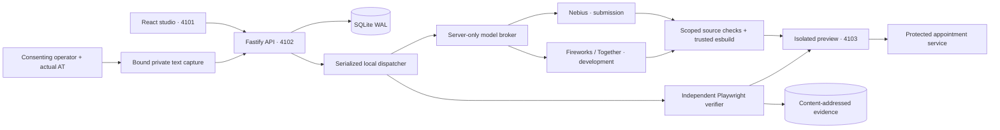

# Architecture and trust boundaries

Passage's implemented edition is local except for explicitly enabled NVIDIA inference. Nebius is the submission route; Fireworks and Together are explicit paid development routes. PostgreSQL, object storage, Cloud Run, and remote Nebius browser workers are future adapters, not provisioned resources.

The 28 October upgrade adds a Journey Compiler, a generic typed temporal interpreter, and a fixed-dependency external React build adapter in a dedicated local Linux VM. The original studio described below remains available with its historical nine-check records. Current compiler/source boundaries, actual external repairs, portable guards and actual screen-reader evidence are described in [Journey Compiler](journey-compiler.md), [repository worker](repository-worker.md), and [actual AT protocol](actual-screen-reader.md). These new workflows do not rewrite old acceptance.

## Source-to-outcome flow

1. An API transaction persists a journey, its initial contract, and a queued baseline. Idempotency keys prevent duplicate logical requests.
2. A single dispatcher compiles the original component and launches a fresh Chromium context. It observes keyboard focus and checks actual appointment service state.
3. The run pauses for contract review. The operator chooses live inference or a clearly labeled handcrafted reference repair.
4. In live mode, the broker sends the authored component, typed contract, recorded observations and public failure feedback to the explicitly selected provider. Receipts preserve provider/model/request, prompt version, timing and usage. The provider's `reasoning_content` field is excluded from storage and exports. A malformed `message.content` field can still contain unexpected prose; it is untrusted diagnostic output, not a verified candidate or progress narration.
5. The broker validates JSON containing a summary and a complete scoped component. Candidate source cannot edit the verifier, fixture host, service validation, build adapter, dependency manifest or contract. Malformed/truncated output is not executed.
6. The adapter parses and bundles browser code. It never imports or evaluates candidate code in Node, and never runs a model-selected command or package script.
7. The verifier uses actual Tab/Enter/Escape input and active-element checks. It compares the requested, displayed and stored date, name and source digest. A keyboard-operable patch that saves another date fails.
8. Challenges create isolated sessions against the same source. Individual failures stay visible; they do not erase a passing baseline or become aggregate success.

## Immutable identity

Build IDs bind the component, fixture, trusted host source, stylesheet, adapter version, package-lock digest, Node version, platform and architecture. Bundle and stylesheet hashes are revalidated on retrieval. Builds stage in temporary directories and are atomically renamed; incomplete staging is not a cache entry.

Sources, screenshots, ARIA snapshots, events, backend outcomes and build receipts carry SHA-256 digests. Exports link the exact candidate, contract, scenario, environment and checks. Safe references to private assistive sessions may be included; participant metadata and transcript content are excluded.

## Execution boundary

The trusted authored adapter limits imports to React, requires one default export and stable interaction hooks, blocks obvious globals/dynamic execution, restricts elements, and rejects backend form overrides. These source checks are **defense in depth, not a general security proof**. The separate external adapter admits immutable public source manifests into a fixed dependency/static build worker in a dedicated local Linux VM. It runs no imported package scripts, model-selected commands, plugins or dependency installation; runtime build containers have no network or host mounts.

Actual execution occurs on a separate loopback origin with no product credentials, nonce-based CSP without `unsafe-eval` or external connections, separate browser storage, blocked outbound verifier traffic, fixed build logic and an independent business service. The product iframe is sandboxed. API Host/Origin checks reject preview-origin and unrelated-webpage requests, including attempts to trigger inference. Source is displayed as text.

The trusted authored boundary is unsuitable for arbitrary hostile repositories. The external adapter supports the disclosed static React dependency catalog, not arbitrary backend services or full monorepos. A public manifest is internally hash-checked; local Git inspection verifies local commit blobs and configured remote, not upstream ancestry. Portable exports retain exact source identity, protected bootstrap and MIT notices. Draft PR publication remains unavailable.

## Persistence and recovery

SQLite WAL holds runs, immutable contract revisions, events, idempotency records and cost. SSE events have monotonic cursors and publish only after transaction commit. Refresh/reconnect reads persisted state.

The local dispatcher is single-process and serialized. Cancellation aborts work and fences subsequent writes. Restart marks incomplete work interrupted, preserves finished artifacts and offers an explicit new retry; it does not claim to resume an in-flight browser. This is a local adaptation, not distributed high availability.

## Model routing and admission

`PASSAGE_PROVIDER` selects one server-side route. Its default is `nebius`; merely adding another API key never changes the route. Endpoints and models use a fixed, verified allowlist. Unsupported models are disabled instead of silently substituted.

| Provider and purpose | Model | Input / output per million tokens |
|---|---|---|
| Nebius · submission | `nvidia/nemotron-3-super-120b-a12b` | $0.30 / $0.90 |
| Nebius · submission | `nvidia/Nemotron-3_5-Lightning` | $0.06 / $0.24 |
| Nebius · submission | `nvidia/Nemotron-3-Ultra-550b-a55b` | $1.00 / $3.00 |
| Fireworks · development | `accounts/fireworks/models/nemotron-3-ultra-nvfp4` | $0.60 / $2.40 |
| Together · development | `nvidia/NVIDIA-Nemotron-3.5-Super-VL` | $0.15 / $0.50 |

These uncached rates were verified on 28 October 2026 and support usage estimates, not invoice claims. Fireworks Ultra is the preferred development route; Together is an explicitly selected alternative. Nebius Ultra completed a real structured smoke and fresh external journey repair through the official `us-central1` endpoint; its actual receipts and scope are in the upgrade evidence. A catalog listing alone is insufficient: Together Ultra was listed but rejected as unavailable for serverless inference and is not an enabled route.

Nebius has a persistent **$2 default admission budget**, configurable through `PASSAGE_NEBIUS_BUDGET_USD` to a finite amount from $0 to $100 within an explicitly authorized allowance. The later upgrade qualification uses a $4 local cap within the existing user authorization. Changing this local admission limit neither clears prior usage nor buys provider credit; each new usage entry records its admission limit. Its validated Super/Lightning profiles use at most 6,000 completion tokens and 120 seconds. Reservations conservatively use UTF-8 input bytes plus framing and the maximum output allowance.

The regional Ultra profile uses 32,000 tokens, 480 seconds, thinking enabled and prompt schema. The external qualification used temperature 0.2. A separate later profile follows [NVIDIA's coding-agent example](https://huggingface.co/nvidia/NVIDIA-Nemotron-3-Ultra-550B-A55B-NVFP4#api-client): temperature 1, top-p 0.95 and `force_nonempty_content: true`. This is a profile experiment, not evidence that temperature caused earlier failures. New receipts and usage rows record actual effective settings and a fingerprint over provider, endpoint, model, decoding fields and token/time/response bounds. Dynamic Ultra qualification requires a strictly parsed completion from the exact served model with that fingerprint; historical unfingerprinted or different-profile completions cannot qualify it. Earlier receipts remain unchanged.

The separately authorized Fireworks and Together development routes have **no artificial dollar cap**; they still record usage and remain paid services. Fireworks Ultra uses `reasoning_effort: high`, a 32,000-token response allowance and a 480-second timeout, with no conflicting disable-thinking flag. The current route supplies a full JSON schema in the prompt and omits `response_format`; local schema validation remains mandatory. Earlier JSON-object and 16,000-token receipts remain unchanged. This protocol change followed observed malformed/truncated outputs, without establishing their cause. Together uses its verified `chat_template_kwargs.enable_thinking: true` control, JSON format, 16,000 tokens and 240 seconds without a `reasoning_effort` field. Its tested `.xyz` endpoint and documented `.ai` alias are separately allowlisted. Only strictly validated final JSON can become a candidate. Receipts state requested settings; actual reasoning-token counts are recorded only when the provider supplies them and are not charged twice.

Malformed final output has a separate diagnostic boundary: the HTTP body is streamed with a route-specific byte limit, and only `message.content` is considered for a bounded, content-addressed diagnostic capture. Captures are capped at 128 kB, with original size and truncation recorded. Failed generations retain request/usage receipts, safe JSON field errors and capture digests; the same three-call allowance includes these failures. Standard source guards are unchanged. Unexpected prose is never coerced into source, quoted at length in the interface, or treated as successful reasoning. Diagnostic exports explicitly identify captured final content; private assistive text remains excluded.

For an authored adapter with exactly one immutable permitted source file, prompt-schema routes can return a complete raw JSX module or one exact code fence. The controller derives the path and before hash from that inspection; the model no longer JSON-escapes source or repeats immutable metadata. Parsing rejects prose, multiple fences, invalid syntax, refusal, truncation and oversized output before the unchanged source-admission/build/frozen-check stages. Receipts identify `single-source` versus `structured-json`. Localization remains structured JSON, and JSON-mode providers and multi-file external repairs retain their existing protocol. Only final `message.content` is parsed in either mode.

All provider requests remain serialized. The original studio limits its loop to three candidates. The new compiler creates one patch per explicit repair attempt with at most three source-citation proposals, retaining every failed call and candidate. The ledger separates providers, requested/served models, pricing and purpose; historical rows without a provider belong to Nebius. Development usage cannot consume or reset the Nebius admission budget. Unknown usage stays conservative within its own provider. An insufficient-credit response disables only that provider until explicit acknowledgment of restored funding, without clearing spend. Admission controls are not provider billing caps.

The first development call was length-limited and rejected. Primary NVIDIA/Nebius guidance confirmed `chat_template_kwargs.enable_thinking=false` for concise structured output. The corrected request/prompt version is recorded in new receipts. No outage silently substitutes another provider or a reference patch.

Legitimate descendant queries are permitted only at direct call sites on a declared React `useRef` variable's `.current`, with a bounded literal selector. Global/ancestor queries, aliases, computed method names and dynamic selectors stay blocked. Positive browser and negative source tests cover this capability. Verifier v2 added roving/active-descendant keyboard navigation and bounded asynchronous selection; v3 additionally rejects opening/focus-only date commitments before the intended activation. Async booking requires a successful availability receipt for the chosen date, so deleting validation cannot create a successful record. Reports expose verifier versions without rewriting old acceptance.

## Modules

| Module | Responsibility |
|---|---|
| `shared/types.ts` | Typed contracts and public records |
| `server/store.ts` | SQLite, transactional events, idempotency and usage |
| `server/provider.ts` | Credential boundary, inference and budget |
| `server/orchestrator.ts` | Runs, candidates, cancellation, version checks and export |
| `server/captures.ts` | Bound private text capture and revocation |
| `engine/safety.ts` | Scoped source validation |
| `engine/host.ts` | Immutable builds, preview server and protected service |
| `engine/verifier.ts` | Independent keyboard and outcome checks |
| `scripts/verify-source.ts` | Bounded exported-source replay with a fresh protected contract, no API/provider/database dependency |
| `fixtures/original/`, `fixtures/reference/` | Authored defects and explicit handcrafted repairs |
| `src/` | React studio |

Primary references: [Nebius structured output](https://docs.tokenfactory.nebius.com/ai-models-inference/json), [Fireworks Ultra route and pricing](https://fireworks.ai/models/fireworks/nemotron-3-ultra-nvfp4), [Fireworks reasoning controls](https://docs.fireworks.ai/guides/reasoning), [Fireworks structured-response guidance](https://docs.fireworks.ai/structured-responses/structured-response-formatting), [NVIDIA Ultra model card](https://huggingface.co/nvidia/NVIDIA-Nemotron-3-Ultra-550B-A55B-NVFP4), [Playwright ARIA snapshots](https://playwright.dev/docs/aria-snapshots), [NVIDIA Lightning model card](https://huggingface.co/nvidia/NVIDIA-Nemotron-3.5-Lightning-30B-A3B-BF16), and [W3C date-picker guidance](https://www.w3.org/WAI/ARIA/apg/patterns/dialog-modal/examples/datepicker-dialog/). DOM snapshots remain distinct from actual assistive-technology speech.
